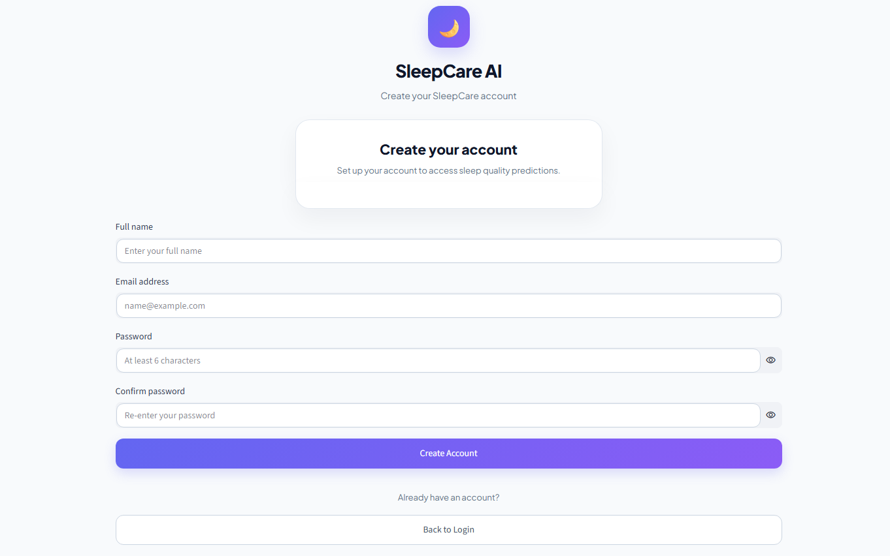
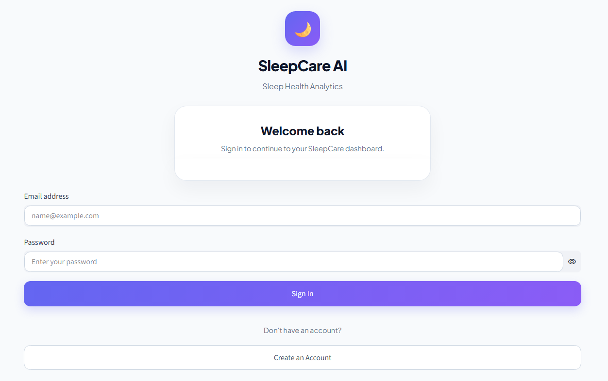
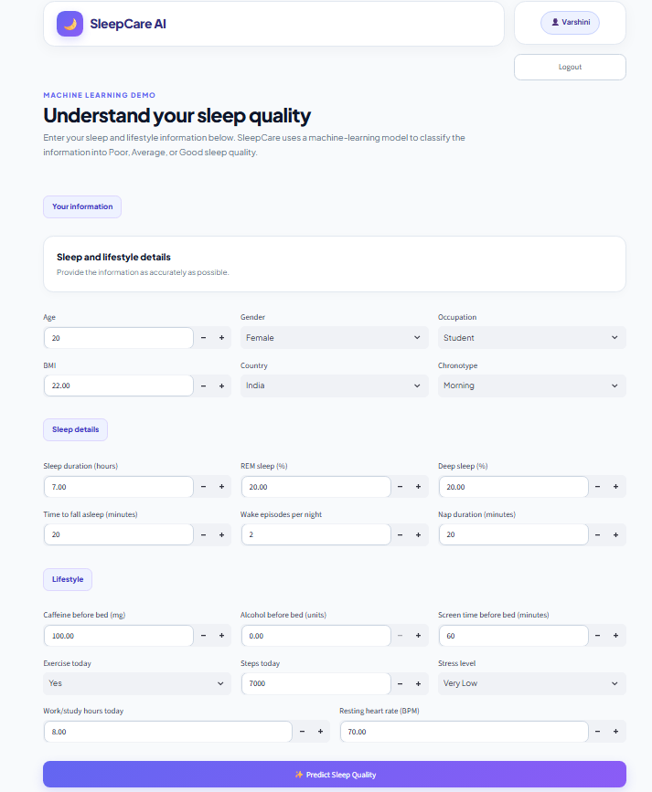
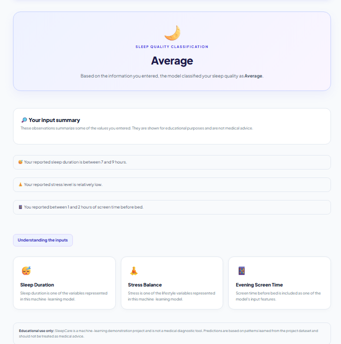

# SleepCare 💤

An educational machine learning application that predicts sleep quality as **Poor**, **Average**, or **Good** based on sleep, lifestyle, activity, and daily routine factors.

---

## Overview

**SleepCare** is a machine learning project designed to explore how different sleep and lifestyle factors relate to sleep quality.

The project includes:

- Data preparation and preprocessing
- Exploratory analysis
- Feature analysis and engineering
- Model training and comparison
- Class balancing
- Cross-validation
- Held-out test evaluation
- Saved machine learning pipeline
- Streamlit web application
- User authentication
- Automated model tests

> **Note:** SleepCare is an educational project and is **not** intended for medical diagnosis.

---

## Features

### Machine Learning

- **100,000-row** sleep dataset
- **20 input features**
- Categorical feature encoding
- Random Forest classification
- Class balancing using `class_weight="balanced"`
- Logistic Regression comparison
- Stratified 5-fold cross-validation
- Held-out test evaluation
- Evaluation using Accuracy, Balanced Accuracy, and Macro F1

### Web Application

- User registration
- Secure password hashing using `bcrypt`
- User login and logout functionality
- Sleep quality prediction interface
- Prediction result display
- Explanation of prediction-related inputs
- Input interpretation

---

## Sleep Quality Categories

The target variable is created from the sleep quality score:

| Sleep Quality Score | Category |
| :--- | :--- |
| **0 – 4** | Poor |
| **5 – 7** | Average |
| **8 – 10** | Good |

---

## Machine Learning

### Input Features

The final model uses 20 features:

- Age
- Gender
- Occupation
- BMI
- Country
- Sleep Duration
- REM Sleep Percentage
- Deep Sleep Percentage
- Sleep Latency
- Wake Episodes Per Night
- Caffeine Before Bed
- Alcohol Before Bed
- Screen Time Before Bed
- Exercise
- Daily Steps
- Nap Duration
- Stress Score
- Work Hours
- Chronotype
- Resting Heart Rate

### Preprocessing

Categorical features are processed using `OneHotEncoder` with:

```text
handle_unknown="ignore"
```

The preprocessing and model are combined into a single **Scikit-learn Pipeline**.

This ensures that the same preprocessing steps used during training are automatically applied when making predictions in the application.

### Final Model

The final model is a **Random Forest Classifier configured with balanced class weights**.

- **Trees:** 200
- **Class Weight:** `"balanced"`
- **Random State:** 42
- **Parallel Processing:** Enabled

---

## Model Evaluation

The final model was evaluated using both a held-out test set and stratified 5-fold cross-validation.

Because the dataset contains an imbalanced distribution across the three classes, **Balanced Accuracy and Macro F1** are reported alongside standard Accuracy to provide a more informative evaluation of minority-class performance.

### Held-Out Test Results

| Metric | Score |
| :--- | :--- |
| **Accuracy** | **78.57%** |
| **Balanced Accuracy** | **71.91%** |
| **Macro F1** | **71.26%** |

### 5-Fold Cross-Validation

| Metric | Mean | Standard Deviation |
| :--- | :--- | :--- |
| **Accuracy** | 78.32% | 0.09% |
| **Balanced Accuracy** | 71.43% | 0.11% |
| **Macro F1** | 70.93% | 0.14% |

The low variation across folds indicates relatively stable performance on this dataset.

### Confusion Matrix

| Actual \ Predicted | Poor | Average | Good |
| :--- | ---: | ---: | ---: |
| **Poor** | 4,886 | 1,140 | 0 |
| **Average** | 1,828 | 10,033 | 654 |
| **Good** | 0 | 664 | 795 |

### Random Forest vs Logistic Regression

| Model | CV Accuracy | CV Macro F1 |
| :--- | :---: | :---: |
| **Logistic Regression** | 78.52% | 66.95% |
| **Balanced Random Forest** | 78.32% | **70.93%** |

Random Forest achieved a higher Macro F1 score, indicating better overall performance across the three sleep-quality classes.

Class-weight tuning was also performed, with the balanced configuration providing the best Macro F1 performance among the tested configurations.

---

## Screenshots

### Register



### Login



### Sleep Prediction



### Prediction Result



---


## Technology Stack

- **Programming:** Python
- **Machine Learning:** NumPy, Pandas, Scikit-learn, Joblib
- **Web Application:** Streamlit
- **Authentication & Database:** SQLite, bcrypt
- **Testing:** Pytest
- **Development Tools:** Git, GitHub, VS Code

---

## Project Structure

```text
sleep/
│
├── .streamlit/
│   └── config.toml
│
├── data/
│   ├── raw/
│   │   └── sleep_health_dataset.csv
│   │
│   └── processed/
│       └── sleep_quality_prepared.csv
│
├── experiments/
│   ├── analysis/
│   │   ├── feature_engineering.py
│   │   ├── feature_importance.py
│   │   └── feature_selection.py
│   │
│   ├── evaluation/
│   │   ├── cross_validation_logistic.py
│   │   ├── final_cross_validation.py
│   │   └── final_evaluation.py
│   │
│   ├── exploration/
│   │   ├── inspect_data.py
│   │   ├── analyze_boundaries.py
│   │   └── check_target_relationship.py
│   │
│   ├── training/
│   │   ├── baseline.py
│   │   ├── train_logistic.py
│   │   ├── train_random_forest.py
│   │   └── train_random_forest_balanced.py
│   │
│   └── tuning/
│       ├── tune_class_weights.py
│       └── tune_random_forest.py
│
├── models/
│   └── sleep_quality_model.pkl
│
├── screenshots/
│   ├── register.png
│   ├── login.png
│   ├── predict.png
│   └── result.png
│
├── src/
│   ├── auth.py
│   └── prepare_data.py
│
├── tests/
│   └── test_saved_model.py
│
├── .gitignore
├── app.py
├── README.md
├── requirements.txt
└── train_final_model.py
```

> The local `venv/` directory, `sleepcare.db` database, and trained `sleep_quality_model.pkl` file are excluded from Git using `.gitignore`. The model file is excluded because of its large size and can be regenerated locally using `train_final_model.py`.
---

## Setup Instructions

### 1. Create a Virtual Environment

```bash
python -m venv venv
```

### 2. Activate the Virtual Environment

**Windows PowerShell:**

```powershell
.\venv\Scripts\Activate.ps1
```

**macOS/Linux:**

```bash
source venv/bin/activate
```

### 3. Install Dependencies

```bash
pip install -r requirements.txt
```

### 4. Verify Installation

```bash
python --version
pip --version
```

---

## Data Preparation & Training

### 1. Prepare the Dataset

Run the preparation script:

```bash
python src/prepare_data.py
```

The script:

- Loads the raw dataset.
- Validates the required target column.
- Converts sleep quality scores into three categories.
- Saves the prepared dataset.

The processed dataset is saved to:

```text
data/processed/sleep_quality_prepared.csv
```

Verify the output using PowerShell:

```powershell
Test-Path data\processed\sleep_quality_prepared.csv
```

Expected:

```text
True
```

### 2. Train the Final Model

```bash
python train_final_model.py
```

The script trains the balanced Random Forest pipeline and saves the serialized model to:

```text
models/sleep_quality_model.pkl
```

Verify the saved model:

```powershell
Test-Path models\sleep_quality_model.pkl
```

Expected:

```text
True
```

> **Note:** The trained model file is approximately **506 MB** and should not be committed directly to a standard GitHub repository without Git LFS or dedicated external model storage.

---

## Running the Application

### 1. Start Streamlit

```bash
streamlit run app.py
```

### 2. Access the Application

Open the local URL provided by Streamlit in your browser.

### 3. Application Flow

1. Register an account.
2. Log in using your credentials.
3. Enter sleep and lifestyle information.
4. Generate a sleep quality prediction.
5. View the prediction result and explanation.
6. Log out when finished.

---

## Testing

Automated tests verify model loading, input feature alignment, and prediction output.

### Run the Test Suite

```bash
pytest -q
```

Expected result:

```text
2 passed
```

The tests verify that:

- The saved model can be loaded successfully.
- The expected feature list is present.
- The model can generate a prediction.
- The prediction belongs to one of the supported classes: `Poor`, `Average`, or `Good`.

---

## Security Practices

### Password Protection

Passwords are hashed using `bcrypt` before being stored.

Passwords are never stored as plain text.

### Database Queries

Parameterized SQL queries are used for database operations to reduce the risk of SQL injection.

### Local File Protection

The `.gitignore` file prevents local and sensitive files such as:

- Virtual environments
- Python cache files
- SQLite databases
- Environment files
- Temporary system files

from being committed to GitHub.

---

## Limitations

- This project is intended for educational and demonstration purposes.
- It is not a medical diagnosis system.
- Sleep quality categories are derived from the dataset's sleep quality score.
- Model performance depends on the quality and distribution of the training data.
- The `Good` class contains fewer samples than the other classes, making it more difficult to predict accurately.
- Predictions should not replace professional medical advice.

---

## Future Improvements

- [ ] Deploy the Streamlit application publicly.
- [ ] Store the trained model using dedicated external model storage or Git LFS.
- [ ] Incorporate additional real-world sleep datasets.
- [ ] Explore additional techniques for improving minority-class performance.
- [ ] Add model monitoring.
- [ ] Add a user dashboard for sleep analytics.
- [ ] Add prediction history and downloadable reports.
- [ ] Improve authentication features for production deployment.

---

## Disclaimer

SleepCare is an educational machine learning project created for learning and demonstration purposes.

The predictions generated by this application are **not medical diagnoses** and should not be used as a substitute for professional medical advice.

---

## Author

**Varshini Samireddi**
